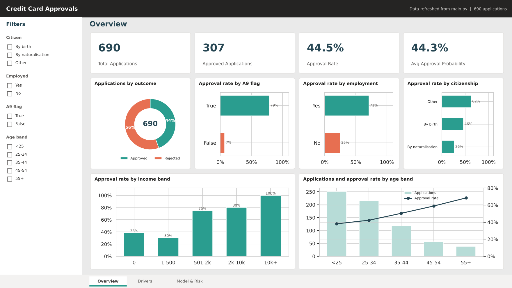
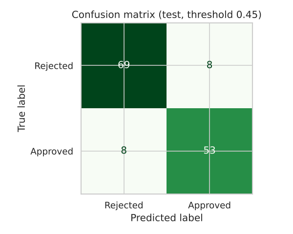
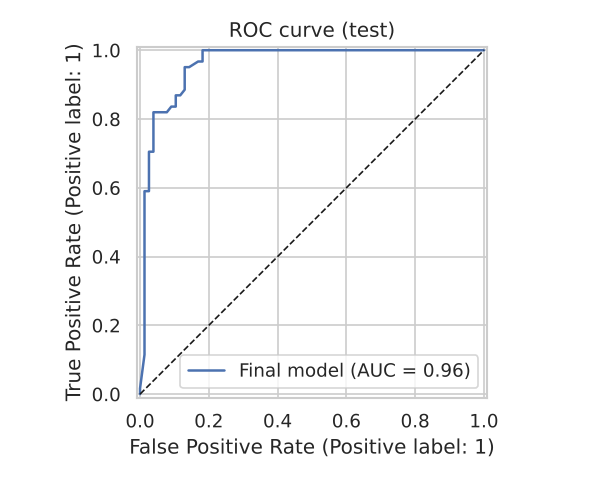
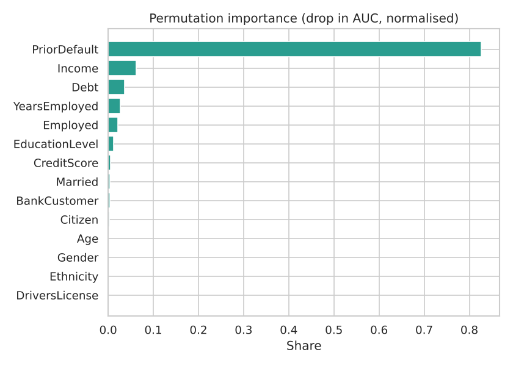
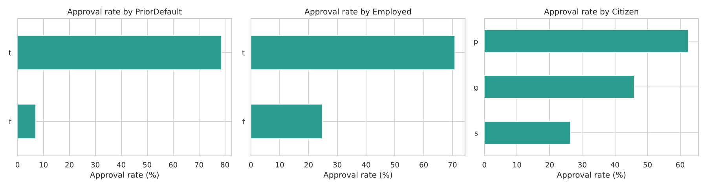
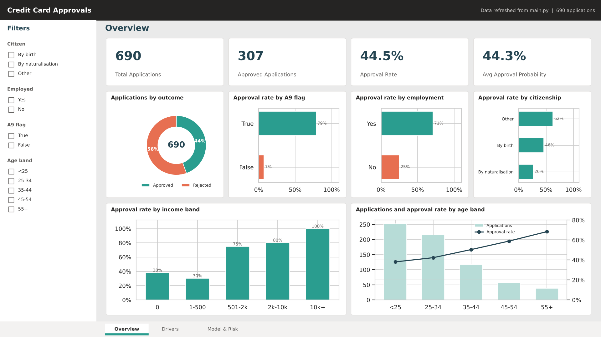
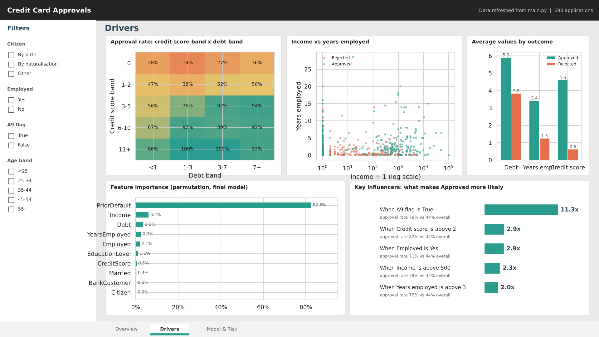
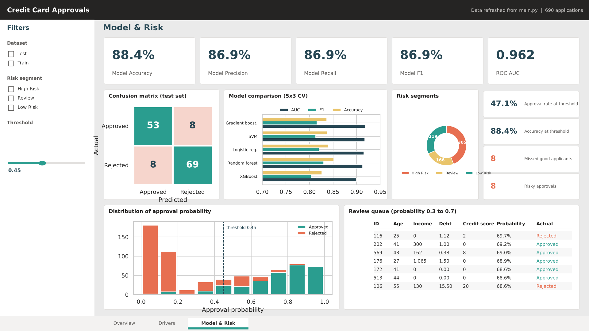

# Credit Card Approval Prediction

A machine learning model that predicts whether a credit card application gets approved, built on the UCI Credit Approval dataset. The repo covers the whole workflow: cleaning, EDA, model selection, tuning, a small Streamlit app for single predictions, and a Power BI report built from the scored data.

Final model: gradient boosting. On a held-out test set of 138 applications it gets 88.4% accuracy and a ROC AUC of 0.962.



## Data

The dataset is `crx.data` from the [UCI repository](https://archive.ics.uci.edu/dataset/27/credit+approval). It has 690 applications, 15 features and a +/- target (307 approved, 383 rejected). 37 rows have at least one missing value, marked with `?`.

The columns are anonymised as A1 to A16. I used the names most people use for this dataset (Gender, Age, Debt, Married, BankCustomer, EducationLevel, Ethnicity, YearsEmployed, PriorDefault, Employed, CreditScore, DriversLicense, Citizen, ZipCode, Income). Treat them as labels, not facts. For example, `PriorDefault = t` has a 79% approval rate, so it almost certainly means "no prior default". In the dashboard it's shown as the neutral "A9 flag" for that reason.

## Running it

```bash
pip install -r requirements.txt
```
```bash
python main.py
```
```bash
pytest -q
```
```bash
streamlit run app/streamlit_app.py
```
```bash
python -m src.predict --input data/sample_new_applicants.csv --output scored.csv
```

`main.py` takes about 25 seconds on a laptop. It downloads the data if it's missing, then writes:
- the charts to `reports/figures/`
- the model to `models/`
- the metrics to `reports/`
- the Power BI tables to `powerbi/data/`

## Layout

```
main.py                 runs everything
src/config.py           paths, column names
src/data_loader.py      download, load, clean
src/features.py         preprocessing pipeline and band columns
src/eda.py              EDA charts
src/train.py            model comparison, tuning, threshold, evaluation
src/export_powerbi.py   CSVs for Power BI
src/dashboard_preview.py  static PNG of the dashboard
src/predict.py          batch scoring
app/streamlit_app.py    web form
powerbi/                data, Power Query, DAX, theme, build guide
docs/                   project report (Word)
tests/                  pytest
```

## Approach

**Preprocessing.** Everything sits inside one scikit-learn pipeline, so the saved model takes raw rows. That way training and scoring can't drift apart.
- Missing numbers are filled with the median, and missing categories with the most frequent value.
- Income, CreditScore, YearsEmployed and Debt are very skewed (Income has a skew of about 13), so they get a `log1p` before scaling.
- Categories are one-hot encoded, and levels with fewer than 10 rows are grouped together.
- ZipCode is dropped.

**Model selection.**
1. I held out 20% of the data as a test set (stratified) and didn't touch it until the end.
2. I compared five models on the remaining 552 rows using 5-fold CV repeated 3 times. With this little data, a single 5-fold split moves around too much to rank models on.
3. I tuned the top three with a 40-iteration random search each.

| Model | Accuracy | Precision | Recall | F1 | AUC | AUC std |
|---|---|---|---|---|---|---|
| Gradient boosting | 0.836 | 0.819 | 0.816 | 0.816 | 0.919 | 0.017 |
| SVM | 0.837 | 0.832 | 0.799 | 0.813 | 0.917 | 0.022 |
| Logistic regression | 0.840 | 0.818 | 0.825 | 0.820 | 0.915 | 0.025 |
| Random forest | 0.851 | 0.846 | 0.818 | 0.830 | 0.913 | 0.023 |
| XGBoost | 0.826 | 0.809 | 0.802 | 0.804 | 0.900 | 0.020 |

These are the untuned scores. After tuning, the CV AUCs were:
- Gradient boosting: 0.939
- SVM: 0.924
- Logistic regression: 0.917

The winning settings are shallow trees: 50 trees, depth 2, learning rate 0.05, subsample 0.7.

**Threshold.** I didn't keep the default 0.5. I picked the cut-off that maximises F1 on out-of-fold predictions from the training set, which came out at 0.45. It's saved with the model, and `predict.py` and the app both use it.

## Results (test set, 138 rows)

| Accuracy | Precision | Recall | F1 | AUC |
|---|---|---|---|---|
| 0.884 | 0.869 | 0.869 | 0.869 | 0.962 |

Confusion matrix: 53 approvals and 69 rejections correct, 8 false approvals, 8 missed approvals.

| | | |
|---|---|---|
|  |  |  |

Feature importance is permutation importance: how much AUC drops when a column is shuffled. The A9 flag accounts for over 80% of it. Income, Debt, YearsEmployed and Employed come next, and the rest barely matter.

## What the EDA showed

- A9 flag: 78.7% approved when `t`, 7.0% when `f`. This is the main driver by a wide margin.
- Employed applicants: 70.8% approved, compared with 24.8% for the rest.
- Approval goes up with income, years employed, credit score and age.
- The classes are close to balanced (44.5% approved), so I didn't resample.



## Power BI report

`main.py` exports four tables to `powerbi/data/`:

- `applications_scored.csv` has one row per application. Along with the original features, it adds:
  - age, income, debt and credit-score bands
  - the model's approval probability and its predicted decision
  - whether each prediction was right (TP / TN / FP / FN)
  - a risk segment (under 0.3 High Risk, 0.3 to 0.7 Review, above 0.7 Low Risk)
  - a train/test flag
- `model_comparison.csv`, `feature_importance.csv` and `test_metrics.csv` hold the model results.

The report has three pages:
- **Overview:** KPIs and approval rates by the main features.
- **Drivers:** a credit score × debt heat map, a scatter, and Key Influencers.
- **Model:** metrics, the confusion matrix, risk segments, and a threshold slider that recalculates approvals and errors.

The steps are in `powerbi/DASHBOARD_GUIDE.md`, and the measures are in `powerbi/DAX_measures.dax`. The page images below are mock-ups drawn with matplotlib from the same CSVs (`python -m src.dashboard_preview`), following the layout in the guide. They show the intended report, not Power BI screenshots. After running `python main.py` again, hit Refresh in Power BI.

**Page 1: Overview**


**Page 2: Drivers**


**Page 3: Model & Risk**


## Limitations

- 690 rows is small. A few applications either way moves test accuracy by a couple of points.
- The features are anonymised, so the business reading of each column is a guess.
- Gender, ethnicity and age are protected attributes. They contribute almost nothing here, but a real lending model would need a fairness check and probably shouldn't use them at all.

## Possible next steps

SHAP values per applicant, a cost-based threshold instead of F1, a FastAPI endpoint, Docker.

## Credits

Dataset: Quinlan, J. R. Credit Approval. UCI Machine Learning Repository, https://doi.org/10.24432/C5FS30 (CC BY 4.0).
